# Schema

What each table holds, how the tables connect, and the rules the database
enforces on them. For the SQL itself see [DATABASE.md](DATABASE.md). The
source is [`backend/sql/schema.sql`](../backend/sql/schema.sql) and
[`backend/sql/routines.sql`](../backend/sql/routines.sql).

**26 tables and 5 views**, in 10 areas. All ids are `BIGINT UNSIGNED
AUTO_INCREMENT`. All tables are InnoDB, so foreign keys and transactions
apply. Text is `utf8mb4`.

## Contents

- [The model in one picture](#the-model-in-one-picture)
- [How the main ideas fit](#how-the-main-ideas-fit)
- [Organisation](#organisation): `department`, `program`
- [Calendar](#calendar): `academic_term`, `period`
- [Classes](#classes): `section`, `lab_batch`
- [Rooms](#rooms): `room`
- [People](#people): `staff`, `student`, `app_user`, `role_assignment`
- [Subjects and who teaches them](#subjects-and-who-teaches-them): `subject`, `subject_offering`, `teaching_assignment`
- [Timetable](#timetable): `timetable_slot`, `slot_batch`
- [When a lecture cannot happen](#when-a-lecture-cannot-happen): `cancellation`, `cover_request`, `makeup_session`, `lecture_log`
- [Syllabus](#syllabus): `syllabus_unit`, `syllabus_topic`, `syllabus_subtopic`, `practical_experiment`, `syllabus_progress`
- [Audit trail](#audit-trail): `audit_log`
- [Views](#views): `vw_assignment_progress`, `vw_class`, `vw_slot_audience`, `vw_staff_load`, `vw_timetable`
- [Rules enforced outside the tables](#rules-enforced-outside-the-tables)

## The model in one picture

Every table with its primary and foreign keys, and every foreign key as a line. `||--o{` reads *one to many*; `|o--o{` means the reference is optional; `||--o|` is *one to at most one*.

```mermaid
erDiagram
    department {
        bigint_unsigned department_id PK
    }
    program {
        bigint_unsigned program_id PK
        bigint_unsigned department_id FK
    }
    academic_term {
        bigint_unsigned term_id PK
    }
    period {
        bigint_unsigned period_id PK
    }
    section {
        bigint_unsigned section_id PK
        bigint_unsigned program_id FK
    }
    lab_batch {
        bigint_unsigned lab_batch_id PK
        bigint_unsigned section_id FK
    }
    room {
        bigint_unsigned room_id PK
    }
    staff {
        bigint_unsigned staff_id PK
        bigint_unsigned department_id FK
    }
    student {
        bigint_unsigned student_id PK
        bigint_unsigned section_id FK
        bigint_unsigned lab_batch_id FK
    }
    app_user {
        bigint_unsigned user_id PK
        bigint_unsigned staff_id FK
        bigint_unsigned student_id FK
    }
    role_assignment {
        bigint_unsigned role_assignment_id PK
        bigint_unsigned staff_id FK
        bigint_unsigned department_id FK
        bigint_unsigned program_id FK
        bigint_unsigned section_id FK
    }
    subject {
        bigint_unsigned subject_id PK
        bigint_unsigned program_id FK
    }
    subject_offering {
        bigint_unsigned offering_id PK
        bigint_unsigned subject_id FK
        bigint_unsigned section_id FK
        bigint_unsigned term_id FK
    }
    teaching_assignment {
        bigint_unsigned assignment_id PK
        bigint_unsigned offering_id FK
        bigint_unsigned lab_batch_id FK
        bigint_unsigned staff_id FK
    }
    timetable_slot {
        bigint_unsigned slot_id PK
        bigint_unsigned assignment_id FK
        bigint_unsigned room_id FK
    }
    slot_batch {
        bigint_unsigned slot_id PK
        bigint_unsigned lab_batch_id PK
    }
    cancellation {
        bigint_unsigned cancellation_id PK
        bigint_unsigned slot_id FK
        bigint_unsigned requested_by_staff_id FK
    }
    cover_request {
        bigint_unsigned cover_id PK
        bigint_unsigned cancellation_id FK
        bigint_unsigned staff_id FK
    }
    makeup_session {
        bigint_unsigned makeup_id PK
        bigint_unsigned cancellation_id FK
        bigint_unsigned room_id FK
        bigint_unsigned staff_id FK
    }
    lecture_log {
        bigint_unsigned log_id PK
        bigint_unsigned slot_id FK
        bigint_unsigned delivered_by_staff_id FK
    }
    syllabus_unit {
        bigint_unsigned unit_id PK
        bigint_unsigned subject_id FK
    }
    syllabus_topic {
        bigint_unsigned topic_id PK
        bigint_unsigned unit_id FK
    }
    syllabus_subtopic {
        bigint_unsigned subtopic_id PK
        bigint_unsigned topic_id FK
    }
    practical_experiment {
        bigint_unsigned experiment_id PK
        bigint_unsigned subject_id FK
    }
    syllabus_progress {
        bigint_unsigned progress_id PK
        bigint_unsigned assignment_id FK
        bigint_unsigned subtopic_id FK
        bigint_unsigned experiment_id FK
        bigint_unsigned completed_by_staff_id FK
        bigint_unsigned log_id FK
    }
    audit_log {
        bigint_unsigned audit_id PK
        bigint_unsigned user_id FK
    }
    student |o--o| app_user : "student_id"
    staff |o--o| app_user : "staff_id"
    app_user |o--o{ audit_log : "user_id"
    timetable_slot ||--o{ cancellation : "slot_id"
    staff ||--o{ cancellation : "requested_by_staff_id"
    cancellation ||--o{ cover_request : "cancellation_id"
    staff ||--o{ cover_request : "staff_id"
    section ||--o{ lab_batch : "section_id"
    timetable_slot ||--o{ lecture_log : "slot_id"
    staff ||--o{ lecture_log : "delivered_by_staff_id"
    cancellation ||--o| makeup_session : "cancellation_id"
    staff ||--o{ makeup_session : "staff_id"
    room ||--o{ makeup_session : "room_id"
    subject ||--o{ practical_experiment : "subject_id"
    department ||--o{ program : "department_id"
    program |o--o{ role_assignment : "program_id"
    staff ||--o{ role_assignment : "staff_id"
    department |o--o{ role_assignment : "department_id"
    section |o--o{ role_assignment : "section_id"
    program ||--o{ section : "program_id"
    lab_batch ||--o{ slot_batch : "lab_batch_id"
    timetable_slot ||--o{ slot_batch : "slot_id"
    department ||--o{ staff : "department_id"
    lab_batch |o--o{ student : "lab_batch_id"
    section ||--o{ student : "section_id"
    program ||--o{ subject : "program_id"
    section ||--o{ subject_offering : "section_id"
    academic_term ||--o{ subject_offering : "term_id"
    subject ||--o{ subject_offering : "subject_id"
    practical_experiment |o--o{ syllabus_progress : "experiment_id"
    staff ||--o{ syllabus_progress : "completed_by_staff_id"
    teaching_assignment ||--o{ syllabus_progress : "assignment_id"
    lecture_log |o--o{ syllabus_progress : "log_id"
    syllabus_subtopic |o--o{ syllabus_progress : "subtopic_id"
    syllabus_topic ||--o{ syllabus_subtopic : "topic_id"
    syllabus_unit ||--o{ syllabus_topic : "unit_id"
    subject ||--o{ syllabus_unit : "subject_id"
    subject_offering ||--o{ teaching_assignment : "offering_id"
    lab_batch |o--o{ teaching_assignment : "lab_batch_id"
    staff ||--o{ teaching_assignment : "staff_id"
    teaching_assignment ||--o{ timetable_slot : "assignment_id"
    room ||--o{ timetable_slot : "room_id"
```



## How the main ideas fit

```
department ─┬─ program ── section (a class) ── lab_batch (G1, G2, G3)
            └─ staff ── role_assignment (one row per role, with its scope)

subject ── subject_offering (one subject, one class, one term)
              └─ teaching_assignment (whole class OR one lab batch, one teacher)
                    └─ timetable_slot (a weekly rule) ── slot_batch (who attends, when not the default)

timetable_slot + a date = a lecture
   ├─ lecture_log      it happened
   └─ cancellation     it cannot happen as planned
         ├─ cover_request   someone else is asked to take it
         └─ makeup_session  it is moved to another time

subject ── syllabus_unit ── syllabus_topic ── syllabus_subtopic
       └── practical_experiment
teaching_assignment ── syllabus_progress (what this teacher has covered with this class or batch)

app_user: a login for exactly one staff member OR one student
audit_log: who changed what
```

The timetable stores weekly *rules*, not individual lectures. A lecture is a
`timetable_slot` on a particular date, and only gets a row of its own when
something happens to it: it is taught (`lecture_log`) or cancelled
(`cancellation`). So a full term of lectures costs no rows until it is used.

## Organisation

### `department`

| Column | Type | Null | Default | Notes |
|---|---|---|---|---|
| `department_id` | `bigint unsigned` |  |  | primary key |
| `code` | `varchar(20)` |  |  | unique |
| `name` | `varchar(160)` |  |  | unique |
| `created_at` | `timestamp` |  | CURRENT_TIMESTAMP |  |

### `program`

| Column | Type | Null | Default | Notes |
|---|---|---|---|---|
| `program_id` | `bigint unsigned` |  |  | primary key |
| `department_id` | `bigint unsigned` |  |  | → `department.department_id` |
| `code` | `varchar(30)` |  |  | unique |
| `name` | `varchar(180)` |  |  |  |
| `short_name` | `varchar(30)` |  |  | "AI&DS", used in class names |
| `degree_level` | `varchar(30)` |  | UNDERGRADUATE |  |
| `duration_years` | `tinyint unsigned` |  | 4 |  |
| `created_at` | `timestamp` |  | CURRENT_TIMESTAMP |  |

- **Check** `chk_program_duration`: `duration_years BETWEEN 1 AND 6`

## Calendar

### `academic_term`

| Column | Type | Null | Default | Notes |
|---|---|---|---|---|
| `term_id` | `bigint unsigned` |  |  | primary key |
| `name` | `varchar(60)` |  |  | unique; "2026-27 Odd Semester" |
| `start_date` | `date` |  |  |  |
| `end_date` | `date` |  |  |  |
| `is_current` | `boolean` |  | 0 |  |
| `current_key` | `tinyint(4)` | yes |  | generated: `if(is_current,1,NULL)`; unique; only one term may be current: NULL for every non-current term, so the unique index below only ever sees one value |

- **Unique** `uq_one_current_term` on the generated column `current_key`
- **Check** `chk_term_dates`: `end_date > start_date`

### `period`

The periods of the teaching day, so the timetable editor offers real slots instead of free-typed times.

| Column | Type | Null | Default | Notes |
|---|---|---|---|---|
| `period_id` | `bigint unsigned` |  |  | primary key |
| `label` | `varchar(30)` |  |  |  |
| `start_time` | `time` |  |  |  |
| `end_time` | `time` |  |  |  |
| `sort_order` | `tinyint unsigned` |  |  |  |

- **Unique** `uq_period_times`: (start_time, end_time)
- **Check** `chk_period_times`: `end_time > start_time`

## Classes

### `section`

| Column | Type | Null | Default | Notes |
|---|---|---|---|---|
| `section_id` | `bigint unsigned` |  |  | primary key |
| `program_id` | `bigint unsigned` |  |  | → `program.program_id` |
| `year_of_study` | `tinyint unsigned` |  |  | 1 FY, 2 SY, 3 TY, 4 LY |
| `division` | `varchar(10)` |  |  | "G" |
| `academic_year` | `varchar(9)` |  |  | "2026-27" |
| `student_count` | `smallint unsigned` |  | 0 |  |

- **Unique** `uq_section`: (program_id, year_of_study, division, academic_year)
- **Check** `chk_section_year`: `year_of_study BETWEEN 1 AND 6`

### `lab_batch`

| Column | Type | Null | Default | Notes |
|---|---|---|---|---|
| `lab_batch_id` | `bigint unsigned` |  |  | primary key |
| `section_id` | `bigint unsigned` |  |  | → `section.section_id` |
| `code` | `varchar(10)` |  |  | "G1" |

- **Unique** `uq_lab_batch`: (section_id, code)

## Rooms

### `room`

| Column | Type | Null | Default | Notes |
|---|---|---|---|---|
| `room_id` | `bigint unsigned` |  |  | primary key |
| `code` | `varchar(30)` |  |  | unique |
| `building` | `varchar(60)` |  |  |  |
| `floor` | `varchar(10)` | yes |  |  |
| `capacity` | `smallint unsigned` |  |  |  |
| `room_type` | `enum('LECTURE','LAB')` |  |  |  |
| `concurrent_capacity` | `tinyint unsigned` |  | 1 | how many lab batches can share the room at once (a big lab can hold two) |

- **Check** `chk_room_capacity`: `capacity > 0`
- **Check** `chk_room_concurrent`: `concurrent_capacity BETWEEN 1 AND 6`

## People

### `staff`

| Column | Type | Null | Default | Notes |
|---|---|---|---|---|
| `staff_id` | `bigint unsigned` |  |  | primary key |
| `department_id` | `bigint unsigned` |  |  | → `department.department_id` |
| `employee_code` | `varchar(30)` |  |  | unique |
| `first_name` | `varchar(80)` |  |  |  |
| `last_name` | `varchar(80)` |  |  |  |
| `email` | `varchar(255)` |  |  | unique |
| `designation` | `varchar(100)` |  | Assistant Professor |  |
| `max_weekly_hours` | `decimal(4,1)` |  | 18.0 |  |
| `is_active` | `boolean` |  | 1 |  |
| `created_at` | `timestamp` |  | CURRENT_TIMESTAMP |  |

- **Check** `chk_staff_hours`: `max_weekly_hours > 0`

### `student`

| Column | Type | Null | Default | Notes |
|---|---|---|---|---|
| `student_id` | `bigint unsigned` |  |  | primary key |
| `section_id` | `bigint unsigned` |  |  | → `section.section_id` |
| `lab_batch_id` | `bigint unsigned` | yes |  | → `lab_batch.lab_batch_id` |
| `prn` | `varchar(30)` |  |  | unique; permanent registration number |
| `roll_no` | `varchar(15)` | yes |  |  |
| `first_name` | `varchar(80)` |  |  |  |
| `last_name` | `varchar(80)` |  |  |  |
| `email` | `varchar(255)` |  |  | unique |
| `is_active` | `boolean` |  | 1 |  |
| `created_at` | `timestamp` |  | CURRENT_TIMESTAMP |  |

### `app_user`

A login. Exactly one of staff_id / student_id is set — which is what keeps the student side of the system entirely separate from the staff side.

| Column | Type | Null | Default | Notes |
|---|---|---|---|---|
| `user_id` | `bigint unsigned` |  |  | primary key |
| `email` | `varchar(255)` |  |  | unique |
| `password_hash` | `varchar(255)` |  |  |  |
| `staff_id` | `bigint unsigned` | yes |  | → `staff.staff_id`; unique |
| `student_id` | `bigint unsigned` | yes |  | → `student.student_id`; unique |
| `must_change_password` | `boolean` |  | 1 |  |
| `is_active` | `boolean` |  | 1 |  |
| `last_login_at` | `datetime` | yes |  |  |
| `created_at` | `timestamp` |  | CURRENT_TIMESTAMP |  |

- **Check** `chk_user_one_owner`: `(staff_id IS NOT NULL AND student_id IS NULL) OR (staff_id IS NULL AND student_id IS NOT NULL)`

### `role_assignment`

One row per role a staff member holds. The scope columns say WHAT the role covers, and which of them must be filled depends on the role:

```
  ADMIN                nothing — the whole system
  FACULTY              nothing — what they teach comes from teaching_assignment
  PROGRAM_DIRECTOR     department_id
  PROGRAM_COORDINATOR  program_id
  YEAR_COORDINATOR     year_of_study, plus EITHER a department (that year
                       across the department) OR a programme
  CLASS_TEACHER        section_id
```

| Column | Type | Null | Default | Notes |
|---|---|---|---|---|
| `role_assignment_id` | `bigint unsigned` |  |  | primary key |
| `staff_id` | `bigint unsigned` |  |  | → `staff.staff_id` |
| `role` | `enum('ADMIN','PROGRAM_DIRECTOR','PROGRAM_COORDINATOR','YEAR_COORDINATOR','CLASS_TEACHER','FACULTY')` |  |  |  |
| `department_id` | `bigint unsigned` | yes |  | → `department.department_id` |
| `program_id` | `bigint unsigned` | yes |  | → `program.program_id` |
| `year_of_study` | `tinyint unsigned` | yes |  |  |
| `section_id` | `bigint unsigned` | yes |  | → `section.section_id` |
| `created_at` | `timestamp` |  | CURRENT_TIMESTAMP |  |
| `scope_key` | `varchar(80)` | yes |  | generated: `concat_ws(':',role,ifnull(department_id,'-'),ifnull(program_id,'-'),ifnull(year_of_study,'-'),ifnull(section_id,'-'))`; the same role with the same scope cannot be given twice |
| `class_teacher_of` | `bigint unsigned` | yes |  | generated: `if(role = 'CLASS_TEACHER',section_id,NULL)`; unique; a class has at most one class teacher |

- **Unique** `uq_role_scope`: (staff_id, scope_key)
- **Unique** `uq_one_class_teacher` on the generated column `class_teacher_of`
- **Check** `chk_role_scope`: `(role IN ('ADMIN','FACULTY') AND department_id IS NULL AND program_id IS NULL AND year_of_study IS NULL AND section_id IS NULL) OR (role = 'PROGRAM_DIRECTOR' AND department_id IS NOT NULL AND program_id IS NULL AND year_of_study IS NULL AND section_id IS NULL) OR (role = 'PROGRAM_COORDINATOR' AND program_id IS NOT NULL AND department_id IS NULL AND year_of_study IS NULL AND section_id IS NULL) OR (role = 'YEAR_COORDINATOR' AND year_of_study IS NOT NULL AND section_id IS NULL AND ((department_id IS NOT NULL AND program_id IS NULL) OR (department_id IS NULL AND program_id IS NOT NULL))) OR (role = 'CLASS_TEACHER' AND section_id IS NOT NULL AND department_id IS NULL AND program_id IS NULL AND year_of_study IS NULL)`

## Subjects and who teaches them

### `subject`

| Column | Type | Null | Default | Notes |
|---|---|---|---|---|
| `subject_id` | `bigint unsigned` |  |  | primary key |
| `program_id` | `bigint unsigned` |  |  | → `program.program_id` |
| `code` | `varchar(30)` |  |  | unique |
| `name` | `varchar(200)` |  |  |  |
| `subject_type` | `enum('THEORY','PRACTICAL')` |  |  |  |
| `credits` | `decimal(3,1)` |  | 0.0 |  |
| `planned_hours` | `decimal(5,1)` |  |  |  |

- **Check** `chk_subject_hours`: `planned_hours > 0`
- **Check** `chk_subject_credits`: `credits >= 0`

### `subject_offering`

A subject offered to one class for one term. The same subject can be offered to many classes.

| Column | Type | Null | Default | Notes |
|---|---|---|---|---|
| `offering_id` | `bigint unsigned` |  |  | primary key |
| `subject_id` | `bigint unsigned` |  |  | → `subject.subject_id` |
| `section_id` | `bigint unsigned` |  |  | → `section.section_id` |
| `term_id` | `bigint unsigned` |  |  | → `academic_term.term_id` |

- **Unique** `uq_offering`: (subject_id, section_id, term_id)

### `teaching_assignment`

Who teaches an offering. lab_batch_id NULL means the whole class; a value means that one batch. The triggers further down make sure the two are never mixed for the same offering, and that the batch really belongs to the offering's class.

| Column | Type | Null | Default | Notes |
|---|---|---|---|---|
| `assignment_id` | `bigint unsigned` |  |  | primary key |
| `offering_id` | `bigint unsigned` |  |  | → `subject_offering.offering_id` |
| `lab_batch_id` | `bigint unsigned` | yes |  | → `lab_batch.lab_batch_id` |
| `staff_id` | `bigint unsigned` |  |  | → `staff.staff_id` |
| `batch_key` | `bigint unsigned` | yes |  | generated: `ifnull(lab_batch_id,0)`; NULLs never collide in a unique index, so the whole-class case is keyed as batch 0 to stop two whole-class teachers being assigned |

- **Unique** `uq_assignment`: (offering_id, batch_key)

## Timetable

### `timetable_slot`

A weekly rule, not a lecture: "this assignment meets Monday 09:30 in VY115". The actual dated lectures are this rule projected across the term.

| Column | Type | Null | Default | Notes |
|---|---|---|---|---|
| `slot_id` | `bigint unsigned` |  |  | primary key |
| `assignment_id` | `bigint unsigned` |  |  | → `teaching_assignment.assignment_id` |
| `room_id` | `bigint unsigned` |  |  | → `room.room_id` |
| `day_of_week` | `enum('MON','TUE','WED','THU','FRI','SAT')` |  |  |  |
| `start_time` | `time` |  |  |  |
| `end_time` | `time` |  |  |  |
| `session_type` | `enum('LECTURE','TUTORIAL','PRACTICAL','EVALUATION')` |  | LECTURE | what kind of session this is. A PRACTICAL must be held in a lab; an EVALUATION of a lab subject can be held in an ordinary classroom. |

- **Check** `chk_slot_times`: `end_time > start_time`

### `slot_batch`

Who attends a session, when it is not simply the teaching assignment's own audience. Most sessions have no rows here: they are for the whole class, or for the one lab batch their assignment covers. Rows narrow or widen that — "DBMS evaluation, G1 and G2 only", or "OOP lab evaluation, all batches together". vw_slot_audience resolves every session to the batches it actually holds.

| Column | Type | Null | Default | Notes |
|---|---|---|---|---|
| `slot_id` | `bigint unsigned` |  |  | primary key; → `timetable_slot.slot_id`, on delete cascade |
| `lab_batch_id` | `bigint unsigned` |  |  | primary key; → `lab_batch.lab_batch_id` |

## When a lecture cannot happen

### `cancellation`

| Column | Type | Null | Default | Notes |
|---|---|---|---|---|
| `cancellation_id` | `bigint unsigned` |  |  | primary key |
| `slot_id` | `bigint unsigned` |  |  | → `timetable_slot.slot_id` |
| `lecture_date` | `date` |  |  |  |
| `reason` | `varchar(500)` |  |  |  |
| `requested_by_staff_id` | `bigint unsigned` |  |  | → `staff.staff_id` |
| `status` | `enum('OPEN','COVERED','RESCHEDULED','WITHDRAWN')` |  | OPEN |  |
| `created_at` | `timestamp` |  | CURRENT_TIMESTAMP |  |

- **Unique** `uq_cancel_once`: (slot_id, lecture_date)

### `cover_request`

Every time someone is asked to cover a cancelled lecture, and what they said. Keeping the full history (rather than overwriting one row) is what lets the system avoid asking the same person twice, and show who declined.

| Column | Type | Null | Default | Notes |
|---|---|---|---|---|
| `cover_id` | `bigint unsigned` |  |  | primary key |
| `cancellation_id` | `bigint unsigned` |  |  | → `cancellation.cancellation_id` |
| `staff_id` | `bigint unsigned` |  |  | → `staff.staff_id` |
| `chosen_by` | `enum('TEACHER','SYSTEM')` |  |  |  |
| `status` | `enum('PENDING','ACCEPTED','DECLINED','WITHDRAWN')` |  | PENDING |  |
| `requested_at` | `timestamp` |  | CURRENT_TIMESTAMP |  |
| `responded_at` | `datetime` | yes |  |  |
| `live_key` | `bigint unsigned` | yes |  | generated: `if(status in ('PENDING','ACCEPTED'),cancellation_id,NULL)`; unique; at most one live (pending or accepted) request per cancellation |

- **Unique** `uq_cover_asked_once`: (cancellation_id, staff_id)
- **Unique** `uq_one_live_cover` on the generated column `live_key`

### `makeup_session`

A make-up class arranged for a lecture nobody could cover.

| Column | Type | Null | Default | Notes |
|---|---|---|---|---|
| `makeup_id` | `bigint unsigned` |  |  | primary key |
| `cancellation_id` | `bigint unsigned` |  |  | → `cancellation.cancellation_id`; unique |
| `session_date` | `date` |  |  |  |
| `start_time` | `time` |  |  |  |
| `end_time` | `time` |  |  |  |
| `room_id` | `bigint unsigned` |  |  | → `room.room_id` |
| `staff_id` | `bigint unsigned` |  |  | → `staff.staff_id` |
| `status` | `enum('PLANNED','DELIVERED','CANCELLED')` |  | PLANNED |  |
| `created_at` | `timestamp` |  | CURRENT_TIMESTAMP |  |

- **Check** `chk_makeup_times`: `end_time > start_time`

### `lecture_log`

What was actually taught.

| Column | Type | Null | Default | Notes |
|---|---|---|---|---|
| `log_id` | `bigint unsigned` |  |  | primary key |
| `slot_id` | `bigint unsigned` |  |  | → `timetable_slot.slot_id` |
| `lecture_date` | `date` |  |  |  |
| `delivered_by_staff_id` | `bigint unsigned` |  |  | → `staff.staff_id` |
| `hours` | `decimal(4,2)` |  |  |  |
| `remarks` | `varchar(500)` | yes |  |  |
| `created_at` | `timestamp` |  | CURRENT_TIMESTAMP |  |

- **Unique** `uq_log_once`: (slot_id, lecture_date)
- **Check** `chk_log_hours`: `hours > 0 AND hours <= 8`

## Syllabus

### `syllabus_unit`

Defined once per subject. Progress through it is tracked per teaching assignment, so each lab batch moves through the experiments on its own.

| Column | Type | Null | Default | Notes |
|---|---|---|---|---|
| `unit_id` | `bigint unsigned` |  |  | primary key |
| `subject_id` | `bigint unsigned` |  |  | → `subject.subject_id` |
| `unit_number` | `tinyint unsigned` |  |  |  |
| `title` | `varchar(200)` |  |  |  |
| `planned_hours` | `decimal(5,1)` |  | 0.0 |  |

- **Unique** `uq_unit`: (subject_id, unit_number)

### `syllabus_topic`

| Column | Type | Null | Default | Notes |
|---|---|---|---|---|
| `topic_id` | `bigint unsigned` |  |  | primary key |
| `unit_id` | `bigint unsigned` |  |  | → `syllabus_unit.unit_id`, on delete cascade |
| `topic_number` | `tinyint unsigned` |  |  |  |
| `title` | `varchar(200)` |  |  |  |

- **Unique** `uq_topic`: (unit_id, topic_number)

### `syllabus_subtopic`

| Column | Type | Null | Default | Notes |
|---|---|---|---|---|
| `subtopic_id` | `bigint unsigned` |  |  | primary key |
| `topic_id` | `bigint unsigned` |  |  | → `syllabus_topic.topic_id`, on delete cascade |
| `subtopic_number` | `tinyint unsigned` |  |  |  |
| `title` | `varchar(250)` |  |  |  |

- **Unique** `uq_subtopic`: (topic_id, subtopic_number)

### `practical_experiment`

| Column | Type | Null | Default | Notes |
|---|---|---|---|---|
| `experiment_id` | `bigint unsigned` |  |  | primary key |
| `subject_id` | `bigint unsigned` |  |  | → `subject.subject_id` |
| `experiment_number` | `tinyint unsigned` |  |  |  |
| `title` | `varchar(250)` |  |  |  |
| `planned_hours` | `decimal(4,1)` |  | 2.0 |  |

- **Unique** `uq_experiment`: (subject_id, experiment_number)

### `syllabus_progress`

| Column | Type | Null | Default | Notes |
|---|---|---|---|---|
| `progress_id` | `bigint unsigned` |  |  | primary key |
| `assignment_id` | `bigint unsigned` |  |  | → `teaching_assignment.assignment_id` |
| `subtopic_id` | `bigint unsigned` | yes |  | → `syllabus_subtopic.subtopic_id` |
| `experiment_id` | `bigint unsigned` | yes |  | → `practical_experiment.experiment_id` |
| `completed_on` | `date` |  |  |  |
| `completed_by_staff_id` | `bigint unsigned` |  |  | → `staff.staff_id` |
| `log_id` | `bigint unsigned` | yes |  | → `lecture_log.log_id` |
| `created_at` | `timestamp` |  | CURRENT_TIMESTAMP |  |

- **Unique** `uq_progress_experiment`: (assignment_id, experiment_id)
- **Unique** `uq_progress_subtopic`: (assignment_id, subtopic_id)
- **Check** `chk_progress_one_item`: `(subtopic_id IS NOT NULL AND experiment_id IS NULL) OR (subtopic_id IS NULL AND experiment_id IS NOT NULL)`

## Audit trail

### `audit_log`

| Column | Type | Null | Default | Notes |
|---|---|---|---|---|
| `audit_id` | `bigint unsigned` |  |  | primary key |
| `user_id` | `bigint unsigned` | yes |  | → `app_user.user_id`, on delete set null |
| `action` | `varchar(40)` |  |  | CREATE / UPDATE / DELETE / LOGIN ... |
| `entity` | `varchar(40)` |  |  | "subject", "timetable_slot" ... |
| `entity_id` | `bigint unsigned` | yes |  |  |
| `summary` | `varchar(300)` |  |  |  |
| `created_at` | `timestamp` |  | CURRENT_TIMESTAMP |  |

## Views

Saved queries the backend reads from like tables. The SQL is in [DATABASE.md → Views](DATABASE.md#7-views).

### `vw_assignment_progress`

How far each teaching assignment is through its syllabus.

Columns: `assignment_id`, `offering_id`, `lab_batch_id`, `staff_id`, `section_id`, `subject_id`, `subject_code`, `subject_type`, `total_items`, `completed_items`

### `vw_class`

Views Every class with its full name and where it sits in the organisation.

Columns: `section_id`, `label`, `year_of_study`, `division`, `academic_year`, `student_count`, `program_id`, `program_code`, `program_short`, `department_id`, `department_code`

### `vw_slot_audience`

Who attends each session: one row per batch, or a single row with a NULL batch when the whole class attends. A session's own slot_batch rows win; without them it has its teaching assignment's audience.

Columns: `slot_id`, `section_id`, `lab_batch_id`

### `vw_staff_load`

Each teacher's scheduled week against their contracted limit.

Columns: `staff_id`, `name`, `max_weekly_hours`, `weekly_hours`, `weekly_sessions`

### `vw_timetable`

The timetable, readable: names instead of ids.

```
  lab_batch_id    the one batch attending, or NULL for the whole class or
                  for several batches (so clash checks treat those as the
                  whole class, which is the safe side)
  lab_batch_code  who attends, for people: 'G1', 'G1, G2', or NULL
```

Columns: `slot_id`, `day_of_week`, `start_time`, `end_time`, `session_type`, `assignment_id`, `lab_batch_id`, `lab_batch_code`, `assignment_batch_id`, `offering_id`, `term_id`, `subject_id`, `subject_code`, `subject_name`, `subject_type`, `section_id`, `class_label`, `staff_id`, `teacher_name`, `room_id`, `room_code`, `room_type`

## Rules enforced outside the tables

Some rules need more than one row to check, so they cannot be a `CHECK`
constraint. Triggers and a procedure enforce them instead. Each is in
[DATABASE.md](DATABASE.md).

| Rule | Enforced by |
|---|---|
| A subject is taught to the whole class or batch by batch, never both; the batch must belong to the class | `sp_check_assignment`, through `trg_assignment_before_insert` / `_update` |
| A student's lab batch belongs to the student's own class | `trg_student_before_insert` / `_update` |
| A lecture can only be logged on the weekday it is timetabled, inside the current term | `trg_log_before_insert` |
| Accepting cover marks the cancellation `COVERED` | `trg_cover_after_update` |
| Booking a make-up marks the cancellation `RESCHEDULED` | `trg_makeup_after_insert` |
| No teacher, room or group of students in two places at once; practicals only in labs | `sp_save_slot`, the only way sessions are created or moved |
| Hours delivered = lectures logged + make-ups held | `fn_delivered_hours` |
